  

## About Me

I enjoy exploring data, solving business problems, and building dashboards that make complex information easier to understand. My main interests are **financial analytics, supply chain analytics, and business intelligence**.

---

## Technical Skills

<table>
<tr>
<td width="50%" valign="top">

### 🗄️ SQL
Joins · CTEs · Window Functions · Subqueries

</td>
<td width="50%" valign="top">

### 🐍 Python
Pandas · NumPy · EDA · Matplotlib · Seaborn

</td>
</tr>
<tr>
<td valign="top">

### 📊 Power BI
DAX · Power Query · Data Modeling · Dashboards

</td>
<td valign="top">

### 📗 Excel
Advanced Formulas · Pivot Tables · Power Pivot

</td>
</tr>
<tr>
<td valign="top">

### 🔧 dbt
SQL Models · Data Testing · ELT · Documentation

</td>
<td valign="top">

### 💻 Git & GitHub
Version Control · Project Documentation

</td>
</tr>
</table>

---

## 🏅 Professional Certifications

- 🟦 **Microsoft Certified: Power BI Data Analyst Associate (PL-300)** — Microsoft
- 📊 **Google Data Analytics Professional Certificate** — Google
- 🗄️ **MySQL Specialist** — Maven Analytics

---

## 🎓 Education

- **Master's Degree in Data Analytics and Project Management**  
  Oulu University of Applied Sciences (OAMK), Finland

- **Bachelor's Degree in International Business**  
  Centria University of Applied Sciences, Finland

- **Bachelor of Business Administration (BBA) in Finance and Banking**  
  International University of Business Agriculture and Technology (IUBAT), Bangladesh

---
  
## Areas of Expertise

- **Supply Chain Analytics:** Inventory, Procurement, Demand Forecasting
- **Financial Analytics:** Budgeting, Variance Analysis, Financial Reporting
- **Business Intelligence:** KPI Tracking, Dashboard Development, Data Visualization

---

## 🚀 My Data Engineering Journey

I'm expanding my expertise in **Data Analytics and Business Intelligence** toward **Data Engineering and Analytics Engineering**. My focus is on learning how to build reliable data pipelines, automate workflows, and prepare high-quality data for business intelligence.

### 🛠️ Currently Learning

- 🐍 **Python & SQL:** Data Processing, Automation & Advanced Querying
- 🔄 **ETL/ELT Pipelines:** Data Integration & Transformation
- 🔧 **dbt:** Data Modeling, Testing & Documentation
- 🏗️ **Data Warehousing:** Star Schema & Dimensional Modeling
- ☁️ **Cloud Platforms:** Microsoft Azure, Snowflake & BigQuery
- ⚙️ **Apache Airflow:** Workflow Scheduling & Orchestration
- 📦 **Docker & Git:** Containerization & Version Control

### 🔨 Planned Data Engineering Projects

| Project | Technologies | Status |
|---|---|---|
| End-to-End ETL Pipeline | Python, SQL, PostgreSQL | 📚 Planned |
| Analytics Engineering Pipeline | dbt, SQL, Data Warehouse | 📚 Planned |
| Automated Data Pipeline | Apache Airflow, Python | 📚 Planned |
| Cloud Data Pipeline | Azure Data Factory, Azure SQL | 📚 Planned |

### 🎯 Career Goal

To combine my background in **Finance, Supply Chain Analytics, and Business Intelligence** with Data Engineering to develop automated, scalable, and reliable data solutions.
  

---

### Thanks for visiting! 👋

*Let's connect and explore the possibilities of data.*

**Ahasan Hasan**  
Data Enthusiast

